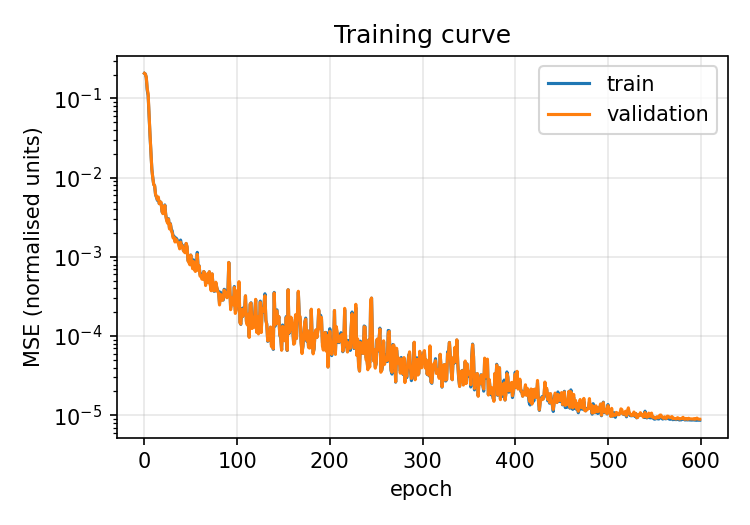
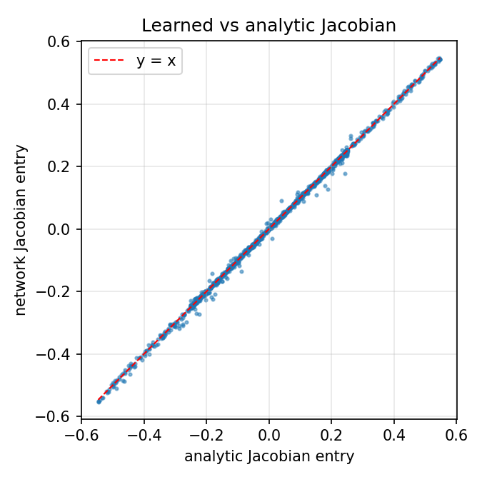
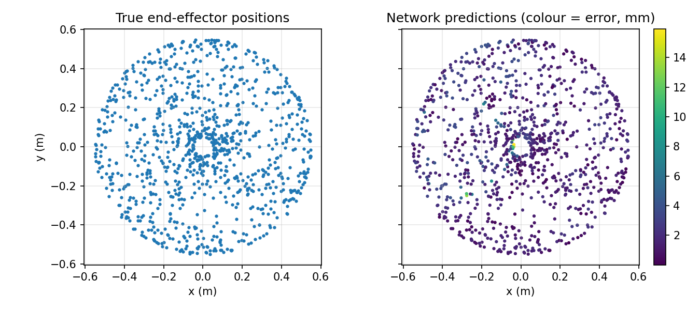

# Learning Robot Kinematics with a Neural Network Built from Scratch (NumPy only)

A multilayer perceptron implemented using only NumPy (backpropagation, Adam and gradient checking all written by hand), trained to learn the **forward kinematics of a 2-link planar robot arm**. I then test whether the network has learned the arm's *physics* and not just its input-output pairs by comparing its **Jacobian** against the analytic one.

No PyTorch, TensorFlow or scikit-learn. Matplotlib is used for plots only.

## The maths

**Robot.** Two links (L1 = 0.30 m, L2 = 0.25 m) with joint angles θ1, θ2. The end-effector position is

```
x = L1 cos θ1 + L2 cos(θ1 + θ2)
y = L1 sin θ1 + L2 sin(θ1 + θ2)
```

and the Jacobian J = ∂(x, y)/∂(θ1, θ2) maps joint velocities to end-effector velocities.

**Network.** Hidden layers: a_l = tanh(W_l a_(l-1) + b_l). Linear output layer. Loss: mean squared error.

**Backpropagation** is the chain rule applied layer by layer. With δ_L = ∂L/∂(output), each hidden layer gives δ_l = (δ_(l+1) W_(l+1)ᵀ) ⊙ (1 − a_l²), using tanh′(z) = 1 − tanh²(z), and the weight gradient is ∂L/∂W_l = a_(l-1)ᵀ δ_l.

**Adam** keeps exponential moving averages of the gradient (m) and squared gradient (v), with bias correction, and updates `p ← p − lr · m̂ / (√v̂ + ε)`. A cosine learning-rate decay is used.

**Network Jacobian.** The same chain rule, applied to the inputs instead of the weights: J_net = W_Lᵀ · diag(tanh′) · … · W_1ᵀ. This is what allows a direct comparison with the robot's analytic Jacobian.

## Verification

Before any training, backprop gradients are checked against centred finite differences, (L(w+ε) − L(w−ε)) / 2ε, on every parameter of a small network. Maximum relative error: **1.3 × 10⁻⁸**, so the gradients are correct.

## Results

Setup: 2 → 64 → 64 → 2 tanh network, 4,000 training samples, 500 validation, 1,000 test, joint angles uniform in [−π, π], 600 epochs, batch size 128.

| Metric (held-out test set) | Value |
|---|---|
| Mean end-effector error | 1.91 mm |
| 95th-percentile error | 4.02 mm |
| Max error | 15.9 mm |
| Final train / validation MSE (normalised) | 8.7 × 10⁻⁶ / 8.9 × 10⁻⁶ |
| Jacobian relative error, median / mean | 1.8% / 2.8% |

The arm's reach is 550 mm, so mean error is about 0.35% of the workspace radius. Train and validation losses are almost identical, so there is no sign of overfitting.

| | |
|---|---|
|  |  |



## What I learned and the limitations

- The network was never shown a Jacobian, yet its derivative matches the analytic one to within about 2%. Fitting the function well gives you a good derivative as a by-product, though not for free: a derivative is a stricter test than an output value.
- Error is mildly higher near the centre of the workspace (mean 2.5 mm within 100 mm of the base, versus about 1.8 mm elsewhere), and the worst outliers sit there. That is where the arm is folded back on itself, so many joint configurations map to nearby points and the function is hardest to fit. I did not investigate this further, so treat it as a hypothesis, not a finding.
- Only **forward** kinematics is learned. Inverse kinematics is multi-valued (elbow-up and elbow-down give the same point), so plain regression would average the two solutions and fail. A natural next step is a mixture-density network or learning the IK as a correction to a Jacobian-based solver.
- The data is noiseless simulation. Real hardware would add backlash, sensor noise and calibration error.

## Setup and run

Python 3.8 or newer is recommended. From the project directory:

```bash
python -m venv .venv
```

Activate the environment, then install the project dependencies:

```bash
# Windows PowerShell
.venv\Scripts\Activate.ps1

# macOS / Linux
source .venv/bin/activate

python -m pip install -r requirements.txt
```

Run the tests and training script:

```bash
python -m unittest discover -v
python train.py
```

Training takes about 10 seconds on a CPU. It checks the gradients, trains the
network, prints the held-out position and Jacobian errors, and writes
`results.json` plus three plots in `figures/`. The random seeds are fixed in
the script for repeatable results.

## Project files

- `nn.py`: NumPy MLP, backpropagation, Adam, gradient checking, and input Jacobian.
- `train.py`: simulated data, training, evaluation, and plot generation.
- `test_nn.py`: regression tests for gradient checking and the input Jacobian.
- `results.json`: metrics from the most recent training run.
- `figures/`: training, workspace, and Jacobian plots.
- `PROJECT_GUIDE.md`: a more detailed explanation of the implementation and results.
